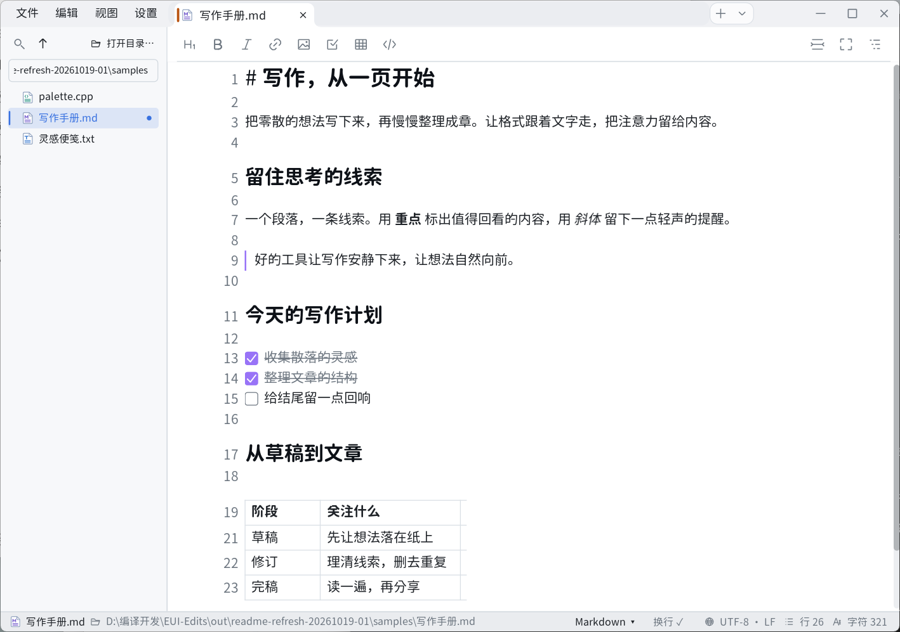
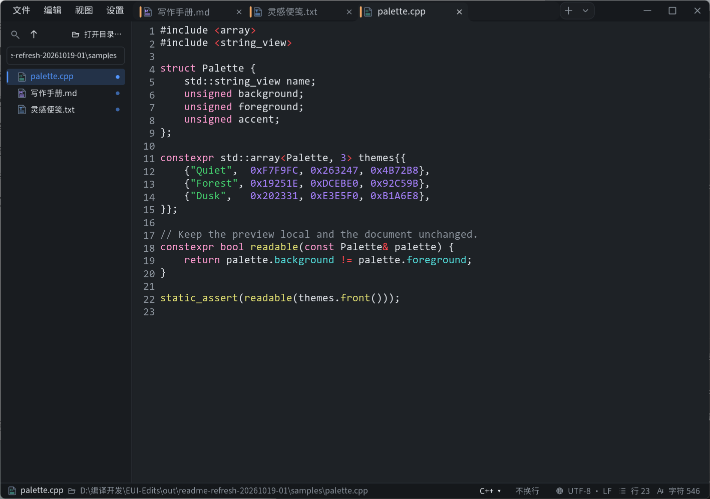
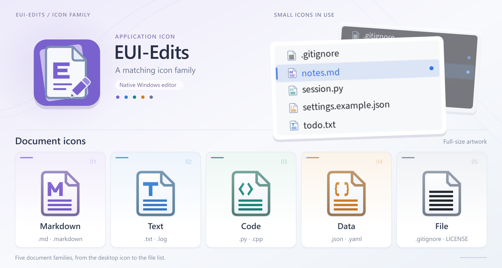

# EUI-Edits

简体中文 · [English](README_EN.md)

EUI-Edits 是面向 Windows 的轻量原生文本与 Markdown 编辑器，适合随手记事、文档写作，以及源码和配置文件的简单编辑。Markdown 在同一视图中即时渲染与原位编辑，格式随输入更新，不必在源码与预览之间切换。

程序采用 C++、Win32 与 Direct2D 构建，按需刷新界面，不嵌入 WebView。无边框窗口将菜单、标签页与窗口控制融入顶部，发行包为免安装的单个 EXE。

## 界面预览

浅色写作界面：无边框顶栏、Markdown 工具栏与即时渲染。



深色代码界面：多标签编辑、行号与基础语法着色。



主题工作台：在样张中查看配色，用起始色生成素净、柔和或鲜明的方案。


应用图标与 Markdown、文本、代码、数据及其他文件的文档图标采用统一设计：



## 编辑体验

- **边写边看 Markdown。** 标题、列表、引用、代码块和表格直接呈现在文稿中，当前编辑区域显示源文。工具栏可插入常用格式；任务项可以勾选，本地图片点击后可预览、缩放与平移。
- **写作与导航。** 打字机模式跟随当前输入行；专注模式收起界面并淡化未选中的非当前行，保留模式入口与窗口控制。右侧大纲可跳转标题，本地 Markdown 与 Wiki 链接支持同页和跨文件标题定位。
- **可拖动的多标签页。** 拖动标签调整顺序，每页独立保留光标、选区、撤销历史、折叠和文档库视图。重复打开同一文件会定位到已有标签；再次启动程序打开文件时，请求会转交给已有窗口。
- **按需加载的文档库。** 侧栏浏览所选目录，包含隐藏文件与无扩展名文件，已打开的文件会标记圆点。目录逐层、分批加载，展开子目录才读取其条目，打开文件才读取正文；支持 `F2` 重命名。
- **各类文本编辑。** Markdown、纯文本、源码和数据文件均可打开。已识别格式提供基础语法着色，也可从「编辑 → 语法模式…」手动切换；查找替换支持限定选区，批量替换可一次撤销，另有自动换行和行号。
- **保存与恢复。** 保存时保留原文件的编码、BOM 和换行类型，检查外部修改并核对写入结果；失败时保留未保存状态与恢复数据。未保存内容定期写入恢复副本，异常退出后可恢复为独立草稿，确认后再保存到文件。

## Markdown 支持

| 语法 | 当前表现 |
| --- | --- |
| 标题（`#` 与下划线式）、段落 | 即时渲染，原位编辑 |
| 粗体、斜体、行内代码、删除线、下划线（`_.._`） | 支持 |
| 链接、Wiki 链接（`[[...]]`） | 可点击跳转 |
| 有序 / 无序列表、任务列表、引用 | 支持；任务项可勾选，引用最多四层 |
| 围栏代码块、表格、分隔线、frontmatter | 支持 |
| 本地图片（独占一行） | 显示图片，点击进入预览 |
| 行内数学 `$...$`、HTML | 数学按代码样式呈现；HTML 保留源码，不执行 |
| 公式排版、远程图片、高亮、注释、脚注、callout、标签 | 暂不支持，源码保持可编辑 |

Markdown 覆盖常见写作语法与部分扩展，不保证完整 Obsidian 兼容。

## 开始使用

从[发布页](https://github.com/fclx512/EUI-Edits/releases)选择版本并下载对应的 `EUI-Edits-<版本>-windows-x64.exe`，放在准备长期使用的位置直接运行，无需解压资源目录。本文介绍 0.2.1 源码的功能，可下载版本以发布页为准。目标平台为 Windows 10/11 x64，目前未签名。本候选的 Windows 10 与跨屏 DPI 验证尚未完成。不同系统、字体与显示设置下的界面和表现可能有所差异。

**0.2.1 更新：** 改进无边框页眉拖拽、窄窗菜单和浮层输入，新增“自动收纳”与窗口置顶，缩小最小窗口宽度。发布前的草稿需经审核，可下载版本以发布页为准；更多变化见[发布说明](apps/neo_editor/RELEASE-NOTES.md)。

### 常用操作

| 操作 | 快捷键 / 方法 |
| --- | --- |
| 新建文本 / 打开文件 | `Ctrl+N` / `Ctrl+O`；也可拖入文件 |
| 新建 Markdown | 「文件 → 新建 → Markdown」 |
| 保存 / 另存为 | `Ctrl+S` / `Ctrl+Shift+S` |
| 关闭当前标签 | `Ctrl+W`；有改动时询问保存、放弃或取消 |
| 下一标签 / 上一标签 | `Ctrl+Tab` / `Ctrl+Shift+Tab` |
| 定位标签 | `Ctrl+1`–`Ctrl+8` 定位相应标签，`Ctrl+9` 定位最后一个 |
| 查找 / 替换 | `Ctrl+F` / `Ctrl+H`；查找选项中可限定选区 |
| 下一匹配 / 上一匹配 | 查找栏打开时按 `F3` / `Shift+F3`，或 `Ctrl+G` / `Ctrl+Shift+G` |
| 打开文档库 / 重命名 | 「文件 → 打开文档库…」；侧栏聚焦项目后按 `F2` |
| 折叠 / 展开当前章节 | `Ctrl+Shift+J` |
| 打字机 / 专注 | Markdown 工具栏右侧按钮；纯文本使用浮动写作按钮 |
| 显示 / 隐藏大纲 | Markdown 工具栏右侧「大纲」按钮 |
| 打开设置 | 顶部「设置」、菜单「视图 → 设置…」或 `Ctrl+,` |

新建文档第一次保存时选择文件名与位置。遇到乱码，可从「文件 → 以编码重新打开」选择编码；需要转换时可用「文件 → 转换为 UTF-8」。编码无法表示新字符时会提示，保存失败或取消后正文仍保留。

打字机与专注适用于 Markdown 和纯文本，模式偏好仅在本次会话保留；专注会收起界面，但不切换为系统全屏。选区内查找是字面文本匹配；若原范围因编辑、撤销或重新加载而失效，会提示并停止选区限定匹配，避免替换到错误位置。重新选择范围或切换为全文后才能继续查找。

图片预览中，滚轮缩放、中键拖动平移，左键点击或 `Esc` 关闭。

### 设置、恢复与文件关联

设置保存在当前 Windows 用户的配置目录，不随 EXE 移动：

| 位置 | 内容 |
| --- | --- |
| `%APPDATA%\EUI-Edits\settings.ini` | 外观、字体、布局、最近文件等偏好 |
| `%APPDATA%\EUI-Edits\session` | 标签会话及未保存内容的恢复副本 |
| `%APPDATA%\EUI-Edits\themes` | 主题库中的本地主题 |

异常退出后，恢复内容作为独立草稿打开，不自动覆盖原文件。正常退出完成保存或放弃确认后会清理恢复会话，下次不会自动重开全部标签。恢复副本定期写入，不是逐次输入的即时保存，重要内容仍应主动保存。

在「设置 → 文件与系统」中可登记当前用户的文件「打开方式」，首次预选 TXT 和 Markdown。可查看已选及待添加、待移除数量，使用「选择推荐项」时不预选 HTML、Shell、批处理和 PowerShell 文件。默认应用需另在 Windows 中选择；移动或重命名 EXE 后应重新登记关联。脚本文件按文本编辑，程序不会执行其中的代码。

## 外观与个性化

多数设置立即生效，并在下次启动时保留：

| 项目 | 可调整内容 |
| --- | --- |
| 语言与主题 | 简体中文 / English；明暗主题可跟随系统或固定选择 |
| 字体 | 正文、代码与界面分别设置；支持导入 `.ttf`、`.otf`、`.ttc`，代码字体检查是否等宽 |
| 字号与缩放 | 正文字号 12–32、界面字号 12–18；在系统 DPI 基础上额外缩放 80%–200% |
| 阅读布局 | 行号、状态栏、自动换行；限制行宽可收窄并居中正文 |
| 文档库与动画 | 简洁 / 文档库视图；悬停、按压等反馈动画可关闭 |

状态栏显示文件位置、文档语言、编码、换行类型、行数和字符数，可切换文档语言与自动换行；窄窗口中部分信息会收起。字体来自本机或自行导入，发行包不附带字体。

**本地主题工作台为测试功能。** 从「设置 → 外观 → 主题库」进入，左侧查看样张，右侧编辑配色或排版。浅色、深色各有 26 项颜色，支持本地自动配色、固定单项颜色、撤销/重做、修改前对比与另存为主题；排版可调行距、段间距、标题比例等。

导入 JSON 或 CSS 时先审阅报告，再创建草稿；也可将主题文件放入上述 `themes` 目录。保存后的主题可跨启动使用，未保存草稿及其撤销历史不跨会话保留。

Obsidian 主题可选择 `manifest.json`（同目录需有 `theme.css`）或直接选择 CSS；导入只映射可识别配色，不执行 CSS，不保证还原布局与插件样式，可随时返回内置配色。

## 资源占用

界面按需刷新；标签切换尽量复用排版与高亮缓存，超出缓存预算时释放较少使用的衍生数据；文档库只扫描元数据，不一次载入目录中的全部正文。关闭交互动画后，悬停和按压不再产生过渡帧。

以下为 **0.1.4 在 Windows 11 下的历史闲置内存参考**，单位 MiB：

| 场景 | 整体工作集 | 专用工作集 | 专用提交量 |
| --- | ---: | ---: | ---: |
| 空白文档，1 个标签 | 46.0 | 15.9 | 21.7 |
| 3 个小 Markdown 标签，合计 2,580 字节，逐页加载后静置 | 55.9 | 21.9 | 28.3 |
| 9 MiB 纯文本，73,728 个文件行 | 118.0 | 87.8 | 101.9 |
| 9 MiB Markdown，同等行数，每行含列表、强调和行内代码 | 216.6 | 186.2 | 207.0 |

以上数据仅供参考，不代表 0.2.1 的实测结果或内存上限。实际占用会随系统、文档内容、设置及编辑操作变化，可能与表中数值不同；三列指标不能相加。

## 当前范围

EUI-Edits 聚焦本地文本编辑，不提供知识库管理、代码补全、编译调试、脚本执行或演示模式。

| 项目 | 支持与边界 |
| --- | --- |
| 文件 | 默认打开上限 **64 MiB**；拒绝超限、疑似二进制或无法可靠解码的文件 |
| 编码 | UTF-8、UTF-16 LE / BE、Windows ANSI 代码页；保存保留原有编码、BOM 和 LF / CRLF 特征 |
| 文档库 | 每个目录分批加载，每批最多 500 项，展开时读取子目录；筛选只覆盖已加载条目，自动监视覆盖根目录直接子项的变化；不递归进入符号链接目录或目录联接点的目标 |
| 恢复 | 最多 **256 个标签项**，恢复正文读取限额为单份 **256 MiB**、合计 **1 GiB**；清单损坏或正文缺失时保留数据并提示，恢复可能不可用 |

## 开发

构建需要 Windows、Visual Studio 2022 / 2026 或 Build Tools（C++ 桌面开发与 Windows SDK）、支持对应生成器的 CMake、PowerShell 7 和 Python 3。第三方依赖源码随仓库提供。

在仓库根目录运行：

```powershell
# 运行检查
pwsh -NoProfile -File ./scripts/check-neoeditor.ps1

# 构建 Release x64 单 EXE
pwsh -NoProfile -File ./scripts/package-neoeditor.ps1 -Version 0.2.1
```

产物为 `out/euiedits-0.2.1-single-exe/EUI-Edits-0.2.1-windows-x64.exe`。源码目录、CMake 目标与脚本名称保留 `neo_editor` 内部标识。

更多构建参数见[发布构建说明](docs/NeoEditor-发布构建说明-2026-10-02.md)，维护与发版说明见[文档导航](docs/目录说明.md)。

## 许可与致谢

EUI-Edits 基于 [EUI-NEO](https://github.com/sudoevolve/EUI-NEO) 开发，仓库保留框架源码，项目遵循 [Apache-2.0 许可](LICENSE)。应用与文档图标为项目自绘资源；第三方库保留各自许可与署名，详见[第三方说明](apps/neo_editor/THIRD-PARTY-NOTICES.md)及 [LICENSES](apps/neo_editor/LICENSES)。字体处理使用了 FreeType Team 的工作。

完整许可与署名文本嵌入 EXE，可在「设置 → 关于」查看和导出。
