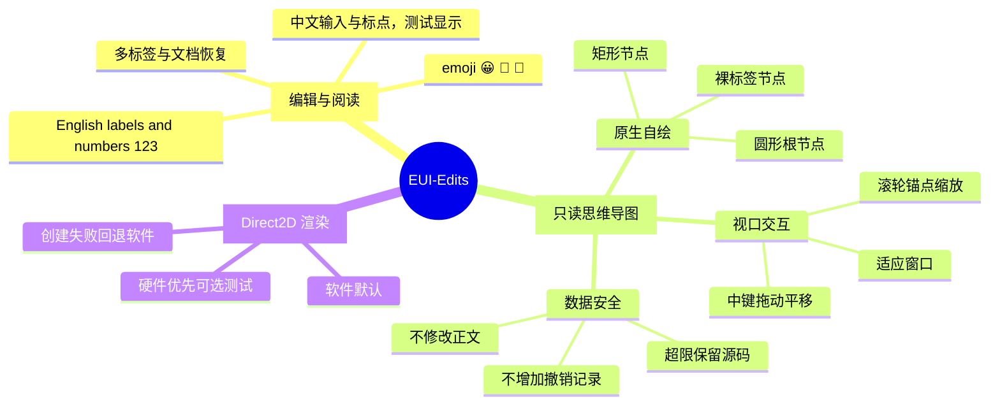
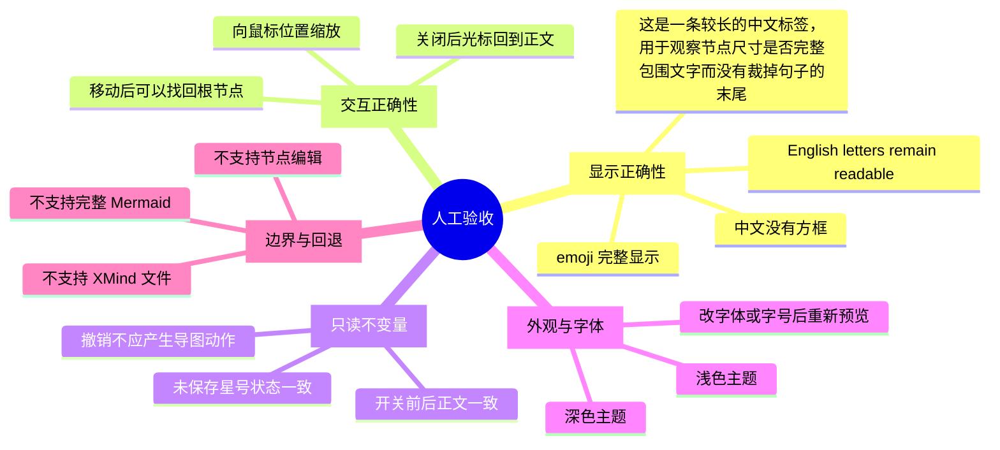
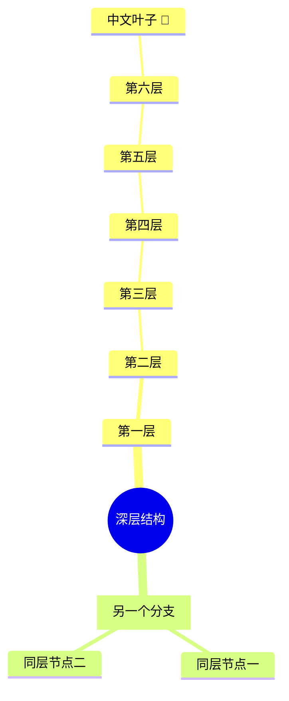

# EUI-Edits 思维导图人工查看样例

这是一份可直接打开的测试文档，不是完整 Mermaid 兼容演示。

## 如何查看

1. 保持在 Markdown 实时预览模式，不要切到源码模式。
2. 点击下面某个 `mermaid` 代码块内的任意一行，把光标放在块内。
3. 从“视图”菜单选择“思维导图预览”。
4. 在预览中滚轮缩放、中键按住拖动平移；使用适应窗口按钮复位。
5. 按 Esc 或点击面板外空白关闭。文档不应变成未保存状态，正文也不应改变。

## 图一：中文与英文混排



## 图二：宽树与长标签

将光标放到这个块内后再次打开预览，应看到“人工验收”而不是上一张图。



## 图三：深树



## 拒绝用例：不应伪造完整 Mermaid 语义

以下块使用本版不支持的样式指令。把光标放入后尝试预览，应提示无法预览并保留原始代码块，不应出现残缺的导图。

```mermaid
mindmap
  root((应当拒绝))
    child[原文保留]
  classDef warning fill:red
```

## 普通 Mermaid：不应被当成思维导图


## 人工记录

- 软件默认：打开、缩放、平移、关闭：待人工查看。
- 硬件优先：打开、缩放、平移、关闭：待人工查看。
- 中文、emoji、长标签、深树：待人工查看。
- 切换主题、字体、字号后重开：待人工查看。
- 输入法、多屏 DPI、低配机器：本文件不代表这些场景已经验收。
